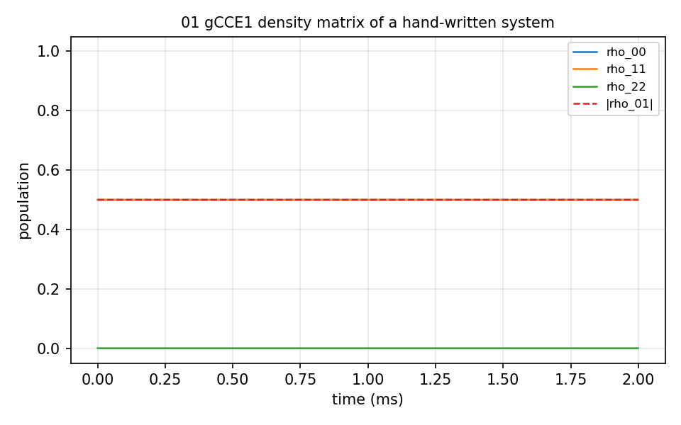

# 01 Arbitrary system

A bath, a gyromagnetic-ratio file and a qubit file written by hand, to show the
three file formats: gCCE of order 1 (`method`, `order`), the density matrix of
one bath state (`quantity` = `dm`), 2000 steps of 1 µs (`deltat`, `nstep`). The
bath is far from the qubit, so the coherence element stays at 0.5 over the 2 ms.
One second.



## The input

`example/tutorial/01_Arbitrary_system/ccein.json`; the whole folder is one calculation. `run.sh` in the same folder runs it as
`mpirun -n $NP bin/main.out -f <this file> -I <bath> -o results/<name>` and then the analyzer.

```
{
    # Config (General)
    "method"        : "gCCE", 
    "quantity"      : "dm",
    "gyrofile"      : "gyro_13C",
    "bathfile"      : ["bath"],
    "order"         : 1,
    "bfield"        : 500,
    "rbath"         : 500,
    "rdip"          : 100,
    "deltat"        : 0.001,
    "nstep"         : 2000,
    "nstate"        : 1,

    "Qubit": {
        "qubit": [
        {
            "name": "qubit1",
            "spin": 1.0,
            "gyro": -17608.597050,
            "xyz": [0.0,0.0,0.0],
            "alphams":  0,
            "betams":  1,
            "detuning": [0.0]
        }]
    },

    # Qubit 
    #"alphams"     : 1,
        #"betams"      : 0,

    # Pulse
    "pulse"         : {"count": 1},

    # Output
    "outfile"     : "./results/CCE2_Diamond_NV_natab_1",
    "savemode"      : "cluster_density_matrix"
}
```
