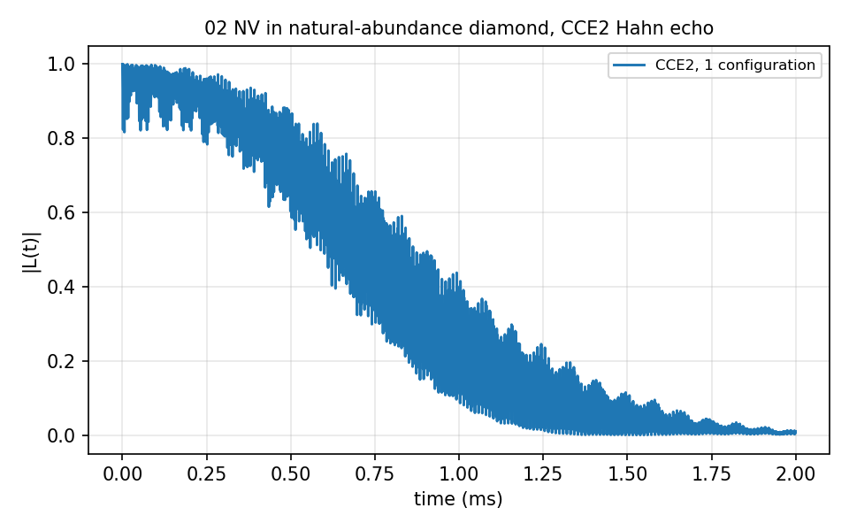
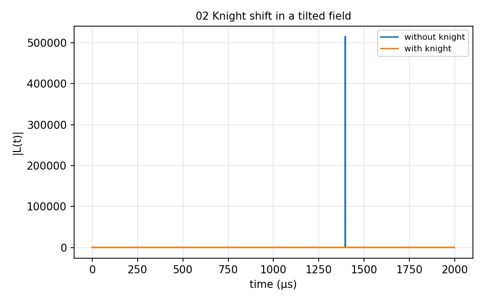

# 02 Diamond NV, natural-abundance ¹³C

The basic case: an NV⁻ centre in diamond with 1.1% ¹³C, `bath/` holding one
configuration of a 150 Å cell, the NV defect file and the ¹³C gyromagnetic
ratio. Five calculations: `ensemble_CCE/` (CCE2 Hahn echo, one run per bath
configuration, then the ensemble average), `single-sample_CCE/` (20 sampled
bath states per configuration, `nstate`), `ensemble_gCCE/` (one and two
qubits), `ensemble_Dsj/` (`method` = `dsj`) and `knight_shift/` (`knight` on
and off in a tilted field). 5 to 60 s each.





## The input

`example/tutorial/02_Diamond_NV_natab/ensemble_CCE/ccein.js`; the other four calculations change `method`, `nstate`, the `Qubit` block or `knight` on this. `run.sh` in the same folder runs it as
`mpirun -n $NP bin/main.out -f <this file> -I <bath> -o results/<name>` and then the analyzer.

```
{
    # Config (General)
    "method"        : "CCE", 
    "quantity"      : "coherence",
    "qubitfile"     : "../bath/bath_Diamond_NV_natab_defect",
    "gyrofile"      : "../bath/gyro_13C",
    "bathfile"      : ["../bath/bath_Diamond_NV_natab_1"],
    "order"         : 2,
    "bfield"        : 500,
    "rbath"         : 50,
    "rdip"          : 10,
    "deltat"        : 0.001,
    "nstep"         : 2000,

    # Qubit 
    "qalphams"     : 1,
    "qbetams"      : 0,

    # Pulse
    "npulse"      : 1,

    # Output
    "outfile"     : "./results/CCE2_Diamond_NV_natab_1"

}
```
