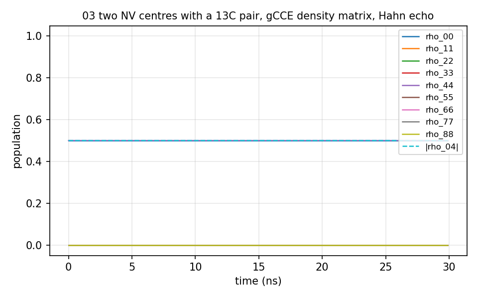

# 03 Diamond, several NV centres

Two and six NV centres with a ¹³C pair, each calculation folder with its own
small bath: the gCCE density matrix of several qubits (`Qubit` block with
`nqubit` > 1), a Ramsey experiment (`npulse` 0) and a Hahn echo. `NV2_13C2/`
runs in a second; `NV6_13C2/` takes 8 minutes for the Hahn echo on 2 ranks and
writes 11 GB of density matrices. The elements of the density matrix that the
free evolution keeps at zero came out `nan` in every version until 2026-09-24;
they are zero now, and the run reports the largest value a cluster would have
put there (4.7e-4 here).



## The input

`example/tutorial/03_Diamond_multiNV_natab/NV2_13C2/ccein_NV6_13C2_hahnecho.js`; the Ramsey input has `npulse` 0. `run.sh` in the same folder runs it as
`mpirun -n $NP bin/main.out -f <this file> -I <bath> -o results/<name>` and then the analyzer.

```
{
    "method" : "gCCE",
    "quantity" : "dm",
    "order" : 1,
    "nstep" : 300,
    "deltat" : 0.0000001,

    "Qubit" : {
                "nqubit" : 2,
                "qubit" : [
                    {"name": "q1", "xyz":[ 75.663000, 74.262800, 74.134800], "spin": 1.0, "gyro": -17608.597050, "alphams": 1, "betams": 0},
                    {"name": "q2", "xyz":[ 75.663000, 74.262800,124.134800], "spin": 1.0, "gyro": -17608.597050, "alphams": 1, "betams": 0}
                ],
                "intmap" : [
                    {"between" : ["q1","q1"], "tensor":[[-960000,0,0],[0,-960000,0],[0,0,1920000]]},
                    {"between" : ["q2","q2"], "tensor":[[-960000,0,0],[0,-960000,0],[0,0,1920000]]}
                ]
    },

    "bathfile"  : ["bath"],
    "statefile" : "state",
    "gyrofile"  : "gyro_13C",
    "rbath"     : 10000,
    "rdip"      : 50000,
    "nstate"    : 1,
    "bfield"    : 500,
    "npulse"    : 1,
    "outfile"   : "./results/CCE2_Diamond_6NV_13C2_1"
}
```
