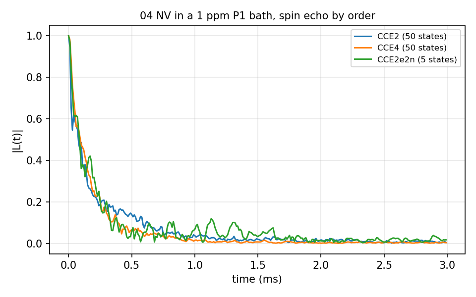
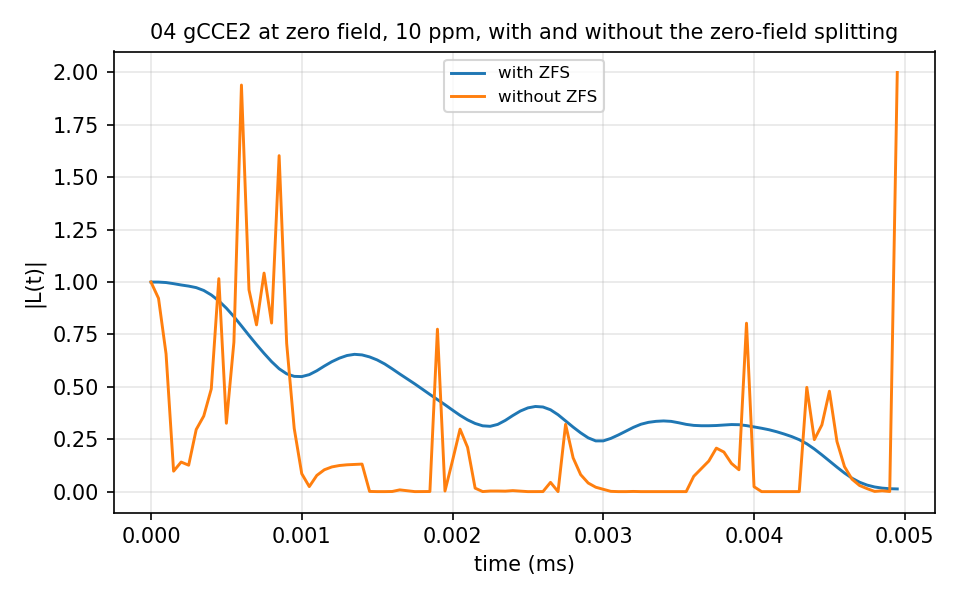
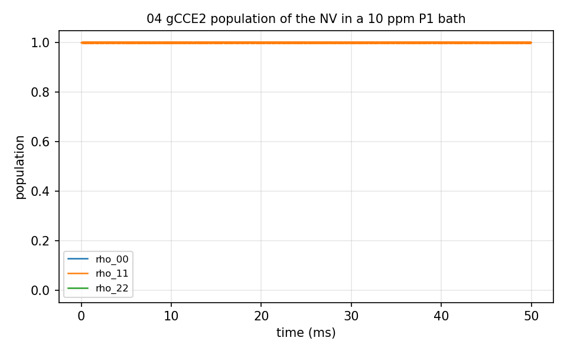

# 04 Diamond NV in a P1 bath

An electron-spin bath: the NV⁻ in P1 centres (an electron with its ¹⁴N) at 1 and
10 ppm, `bath/14N_<ppm>ppm/` holding the configurations, the defect files and
the DFT tensor sets. The bath states are sampled (`-N`, `nstate`), and the
figures average over them. `SpinEcho_CCE2_1ppm/`, `SpinEcho_CCE4_1ppm/` and
`SpinEcho_CCE2e2n_1ppm/` are the order check (CCE2 against CCE4, and the
electron-electron-nuclear clusters); `SpinEcho_gCCE2_10ppm_ZFS/` is gCCE2 at
zero field with and without the NV zero-field splitting (a self entry of `Qubit.intmap` in
`ccein_with_ZFS.json`, the top-level `qzfs` of the `qubitfile` form in `ccein_with_ZFS_v2.json`);
`Population_gCCE2_10ppm/` is the population (density matrix, `npulse` 0);
`SpinEcho_pCCE2_1ppm/` runs pCCE2 with `sK` 1 to 4 spins per partition (heavy;
not in the figures). With 50 states, CCE2 took 2 minutes and CCE4 7 minutes;
CCE2e2n 7 minutes with 5 states; the ZFS pair 8 s.





The population of the initial level stays at 1 over the 50 ms of this one-configuration,
one-state run (100 s); the recorded run averaged more.



## The input

`example/tutorial/04_Diamond_NV_P1Bath/SpinEcho_CCE2_1ppm/ccein.json`; the other calculations change `order`, `method`, the zero-field splitting (`intmap`/`qzfs`) and the sampled states. `run.sh` in the same folder runs it as
`mpirun -n $NP bin/main.out -f <this file> -I <bath> -o results/<name>` and then the analyzer.

```
{
    # Config - Method 
    "method"        : "CCE", 
    "quantity"      : "coherence",
    
    # Config - File
    "qubitfile"     :  "../bath/14N_1ppm/bath_DiaP1_1ppm_Defect",
    "gyrofile"      :  "../bath/DiaP1_gyro",
    "bathfile"      : ["../bath/14N_1ppm/bath_DiaP1_1ppm_"],
  #"avaaxfile"     :  "Random",
  #"statefile"     :  "Random",
  #"exstatefile"   :  "Random",

    # Config - General
    "order"         : 2,
    "bfield"        : 500,
    "rbath"         : 850,
    "rdip"          : 620,
    "deltat"        : 0.01,
    "nstep"         : 300,  

    # Qubit 
    "qalphams"     : -1,
    "qbetams"      : 0,

    # Cluster
    "addsubclus"  : 0, # true / false
    "nk"          : [0,0,0], # default : [0] (all) or [0,0,30,40,50]

    # Pulse
    "npulse"      : 1,

    # Config - Spin tensor
    "hf_readmode"   : 0, 
#  "hf_tensorfile" : "0",
#  "qd_readmode"   : 0,

    # Output
    "savemode"    : "coherence"

,  "Defect"         : [
		{   
            "dfname": "P1",
            "apprx": true,
            "naddspin" : 0,
            "navaax" : 12, 
            "detuning" : [ [1,  "e",   84.946496],
                           [2,  "e",   84.946496],
                           [3,  "e",   84.946496],
                           [4,  "e",     0.00000],
                           [5,  "e",     0.00000],
                           [6,  "e",     0.00000],
                           [7,  "e",  -84.946496],
                           [8,  "e",  -84.946496],
                           [9,  "e",  -84.946496],
                           [10, "e",  114.026400],
                           [11, "e",     0.00000],
                           [12, "e", -114.026400]]
        }   

                       ]
}
```
