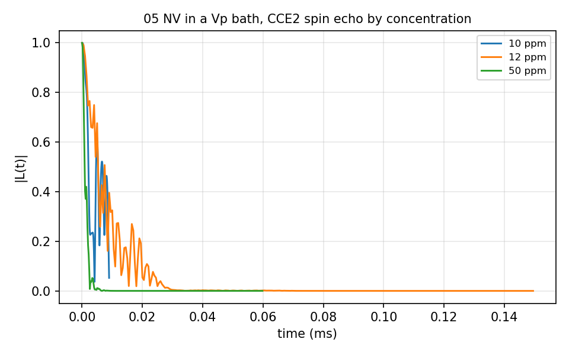

# 05 Diamond NV in a Vp bath

The same spin echo over concentrations of a Vp defect bath: `SpinEcho_CCE2/`
with one input per concentration, 10, 12 and 50 ppm, `bath/<ppm>ppm/` holding
the configurations. 12 s for the three.



## The input

`example/tutorial/05_Diamond_NV_VpBath/SpinEcho_CCE2/ccein_10ppm.json`; the 12 and 50 ppm inputs point at the other bath folders. `run.sh` in the same folder runs it as
`mpirun -n $NP bin/main.out -f <this file> -I <bath> -o results/<name>` and then the analyzer.

```
{
    # Config - Method 
    "method"        : "CCE", 
    "quantity"      : "coherence",
    
    # Config - File
    "qubitfile"     :  "../bath/10ppm/bath_DiaVp_10ppm_Defect",
    "gyrofile"      :  "../bath/DiaVp_gyro",
    "bathfile"      : ["../bath/10ppm/bath_DiaVp_10ppm_"],
  #"avaaxfile"     :  "Random",
  #"statefile"     :  "Random",
  #"exstatefile"   :  "Random",

    # Config - General
    "order"         : 2,
    "bfield"        : 500,
    "rbath"         : 370,
    "rdip"          : 330,
    "deltat"        : 0.00003,
    "nstep"         : 300,  

    # Qubit 
    "qalphams"     : -1,
    "qbetams"      : 0,

    # Cluster
    "addsubclus"  : 0, # true / false
    "nk"          : [0,0,0], # default : [0] (all) or [0,0,30,40,50]

    # Pulse
    "npulse"      : 1,

    # Config - Spin tensor
    "hf_readmode"   : 0, 
#  "hf_tensorfile" : "0",
#  "qd_readmode"   : 0,

    # Output
    "savemode"    : "coherence"

}
```
