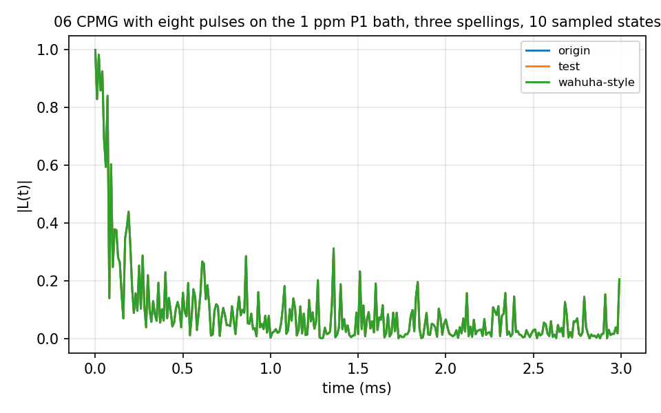
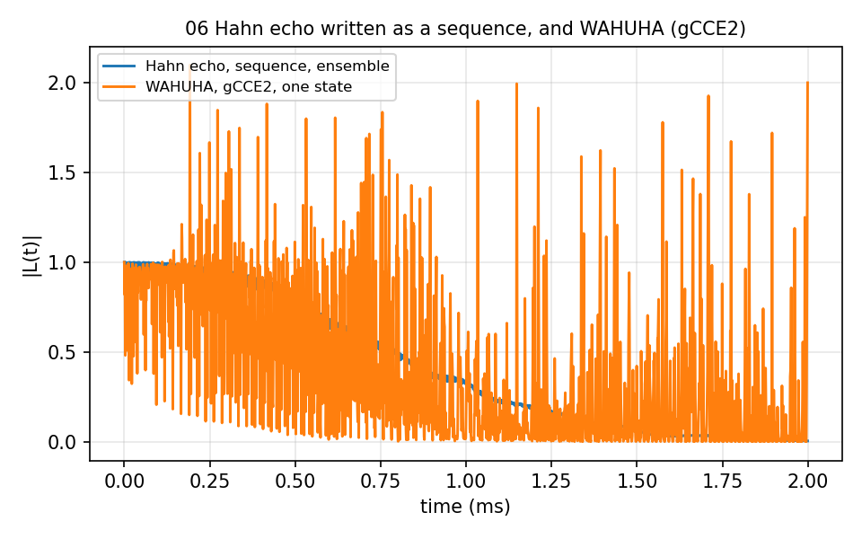

# 06 Pulse sequences written out

The `sequence` key: every pulse as `[fraction, axis, angle]` with
`pulsename` = `Manual`. `HahnEcho_natab_*` write the Hahn echo of 02 this way
(ensemble and single-state, in two spellings), `SpinEcho_P1_1ppm/` and
`CPMG_P1_1ppm/` the spin echo and an eight-pulse CPMG on the P1 bath of 04,
`WAHUHA_*` the four-pulse WAHUHA sequence (90° pulses) on both systems.
`WAHUHA_natab_single_ccce/` is refused by the current code and kept as
recorded: `method` = `CCE` applies every pulse as a π flip, so WAHUHA needs the
gCCE folder. 4 to 30 s each with one bath state; the CPMG figure averages 10 sampled
states (`NSTATE=10`, 3 minutes).





## The input

`example/tutorial/06_Pulse_Manual/WAHUHA_natab_single_gcce/ccein.json`; the `sequence` block is the point; the CPMG input has nine entries. `run.sh` in the same folder runs it as
`mpirun -n $NP bin/main.out -f <this file> -I <bath> -o results/<name>` and then the analyzer.

```
{
    # Config (General)
    "method"        : "gCCE", 
    "quantity"      : "coherence",
    "qubitfile"     : "../bath/bath_Diamond_NV_natab_defect",
    "gyrofile"      : "../bath/gyro_13C",
    "bathfile"      : ["../bath/bath_Diamond_NV_natab_1"],
    "order"         : 2,
    "bfield"        : 500,
    "rbath"         : 50,
    "rdip"          : 10,
    "deltat"        : 0.001,
    "nstep"         : 2000,
    "nstate"        : 1,
    "seed"          : 9407,

    # Qubit 
    "qalphams"     : 1,
    "qbetams"      : 0,

    # Pulse
    "npulse"      : 4,
    "pulsename"   : "WAHUHA",

    # Output
    "outfile"     : "./results/CCE2_Diamond_NV_natab_1"

}
```
