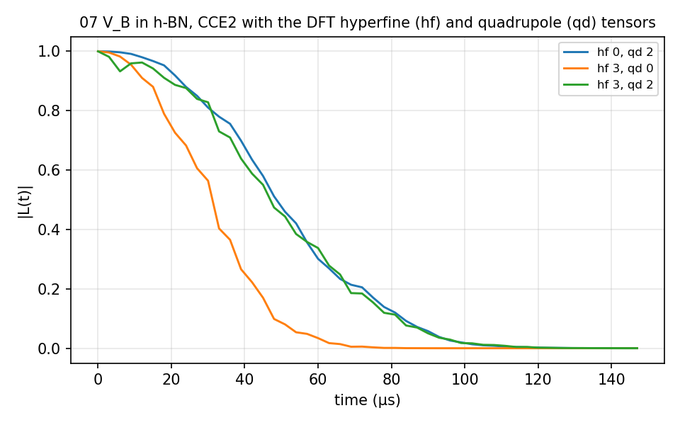
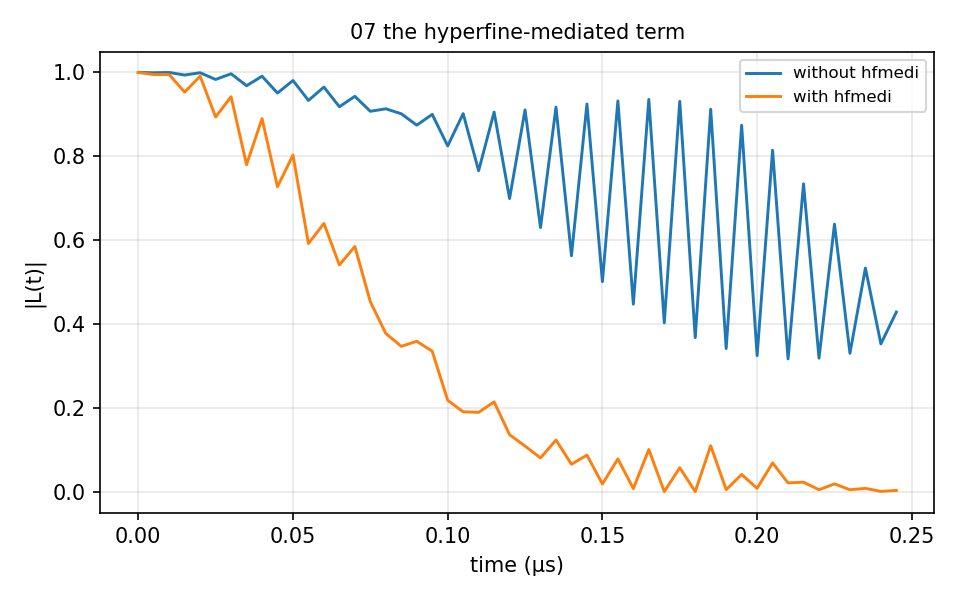
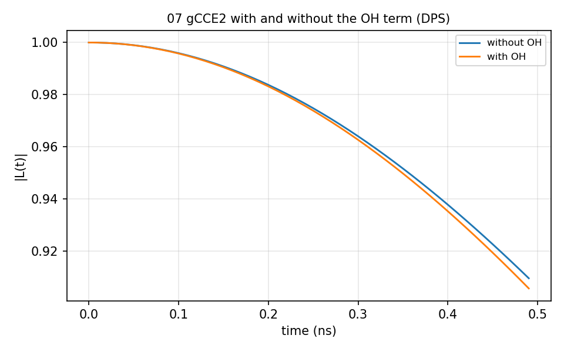

# 07 h-BN V_B⁻

The boron vacancy in hexagonal BN with natural-abundance ¹⁰B, ¹¹B and ¹⁴N, and
the DFT hyperfine and quadrupole tensors in `bath/flat/` (made with
`example/tools/SpinTensorReader`). `ensemble_CCE/` reads the tensors
(`hf_readmode`, `qd_readmode`) in three combinations; `hyperfine_mediated_term/`
turns `hfmedi` on and off; `single-sample_gCCE_DPS/` is gCCE2 with and without
the `OH` term. 3 to 11 s each.







## The input

`example/tutorial/07_hBN_VB_natab/ensemble_CCE/ccein_hf3_qd2.js`; the other two inputs set `hf_readmode` and `qd_readmode` to 0. `run.sh` in the same folder runs it as
`mpirun -n $NP bin/main.out -f <this file> -I <bath> -o results/<name>` and then the analyzer.

```
{
    # Config (General)
    "method"        : "CCE", 
    "quantity"      : "coherence",
    "qubitfile"     : "../bath/flat/bath_hBN_VB_flat_Defect",
    "gyrofile"      : "../bath/hBN_natab_gyro",
    "bathfile"      : ["../bath/flat/bath_hBN_VB_flat_1"],
    "order"         : 2,
    "bfield"        : 30000,
    "rbath"         : 20,
    "rdip"          : 10,
    "deltat"        : 0.003,
    "nstep"         : 50,
    "nstate"        : 0,

    # Qubit 
    "qalphams"     : 1,
    "qbetams"      : 0,

    # Pulse
    "npulse"      : 1,

    # Bath HF
    "hf_readmode"   : 3,
    "hf_tensorfile" : "../bath/flat/hBN_VB_flat_ATensor_HSE_CellPBE_tag",
    "hf_ignore_oor" : 0,
    "DefectTotSpin" : 1.0,
    "CorrTotSpin"   : 0.0,

    # Bath QD
    "qd_readmode" : 2, #0 (X), exp, dft(2 widefect) dft(wi+wo defect), dft(wi+wo defect)
    "qd_tensorfile" : "../bath/flat/hBN_VB_flat_QTensor_HSE_CellPBE",
    "qd_tensorfile_woqubit" : "../bath/flat/hBN_VB_flat_QTensor_HSE_CellPBE",
    "qd_cellpara" : [0.0, 0.0, 0.0],

    # Output
    "outfile"     : "./results/gCCE2_hBN_VB_natab_1"

    # Bath
    #"Bath" : {
    #    [ 'bath1', {'xyz': [], 'gyro': '' , 'A': [tensor], 'Q': [tensor] },
    #    [ 'bath1', {'xyz': [], 'gyro': '' , 'A': [tensor], 'Q': [tensor] },
    #    [ 'bath1', {'xyz': [], 'gyro': '' , 'A': [tensor], 'Q': [tensor] },
    #    [ 'bath1', {'xyz': [], 'gyro': '' , 'A': [tensor], 'Q': [tensor] },
    #    [ 'bath1', {'xyz': [], 'gyro': '' , 'A': [tensor], 'Q': [tensor] },
    #    [ 'bath1', {'xyz': [], 'gyro': '' , 'A': [tensor], 'Q': [tensor] },
    #    [ 'bath1', {'xyz': [], 'gyro': '' , 'A': [tensor], 'Q': [tensor] },
    #    [ 'bath1', {'xyz': [], 'gyro': '' , 'A': [tensor], 'Q': [tensor] },
    #    [ 'bath1', {'xyz': [], 'gyro': '' , 'A': [tensor], 'Q': [tensor] },
    #    [ 'bath1', {'xyz': [], 'gyro': '' , 'A': [tensor], 'Q': [tensor] }
    #}

}
```
