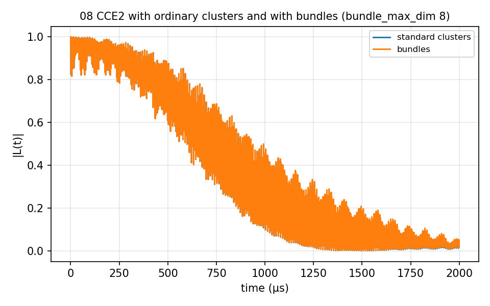

# 08 Bundle clustering

The clustering this branch added, on the NV of 02. `CCE2_bundle/` runs the
same CCE2 Hahn echo with ordinary clusters and with bundles of up to three ¹³C
(`cluster_mode` = `adaptive`, `bundle_max_dim` 8): the 199 spins become 84
bundles, and the two curves differ by 1.7e-2 at most. `CCE2_adaptive/` adds the
`Adaptive` block (merge policy, `atol` 1e-3, an explicit `seed`): three rounds
took the bundles from 28 to 26 and stopped at "no feasible improving merge";
`results/adaptive/` holds one folder per step and `summary.json`. 14 s and 6
minutes.



## The input

`example/tutorial/08_Bundle_clustering/CCE2_adaptive/ccein.json`; `CCE2_bundle/` has the same clustering keys without the `Adaptive` block, beside a standard input. `run.sh` in the same folder runs it as
`mpirun -n $NP bin/main.out -f <this file> -I <bath> -o results/<name>` and then the analyzer.

```
{
    # Config (General)
    "method"        : "CCE",
    "quantity"      : "coherence",
    "qubitfile"     : "../bath/bath_Diamond_NV_natab_defect",
    "gyrofile"      : "../bath/gyro_13C",
    "bathfile"      : ["../bath/bath_Diamond_NV_natab_1"],
    "order"         : 2,
    "bfield"        : 500,
    "rbath"         : 20,
    "rdip"          : 10,
    "deltat"        : 0.01,
    "nstep"         : 200,
    # seed : the refinement recomputes the same system round after round, so the seed must be explicit
    "seed"          : 9407,

    # Clustering : bundles as in ../CCE2_bundle/ccein_bundle.json
    "cluster_mode"    : "adaptive",
    "bundle_max_dim"  : 8,

    # Qubit : ms = +1 / 0 of the NV, one pi pulse (Hahn echo)
    "qalphams"       : 1,
    "qbetams"        : 0,
    "npulse"        : 1,

    # Adaptive : with this block the bundled calculation is refined (docs/adaptive-input-block.md);
    #            without it, it runs once. The run computes, measures the error at each bundle
    #            boundary, re-bundles and computes again, until the curve changes by less than
    #            atol (absolute) + rtol (relative) or max_rounds is reached.
    #            policy : merge, the only one (the default; four others were removed on 2026-10-10)
    #            Everything goes to "output": one folder per step (0001-run, 0002-probe, ...) and summary.json.
    "Adaptive" : {
        "policy"     : "merge",
        "output"     : "./results/adaptive",
        "atol"       : 1e-3,
        "rtol"       : 0,
        "max_rounds" : 4
    },

    "outfile"       : "./results/CCE2_adaptive_1"
}
```
