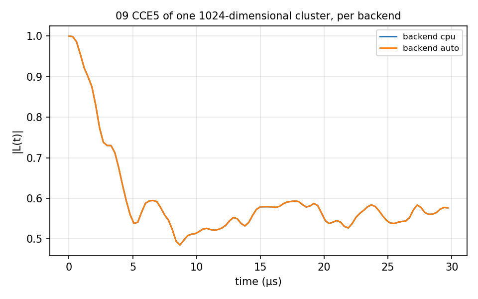

# 09 GPU backend

`backend` in the input: `cpu`, `auto` (CUDA for every cluster whose Hilbert
dimension is at least `gpu_options.min_dim`) or `cuda`. `CCE5_P1/` is a CCE5 Hahn echo
of the NV in a five-spin P1 bath, one cluster of dimension 1024, the case the
GPU is for; `run.sh` runs `cpu` with `bin/main.out` and `auto` and `cuda` with
`bin/main_gpu.out` when that exists (so that `auto` uses the GPU), and prints the largest difference between
the curves and the `profile` timings. Without `bin/main_gpu.out` `auto` runs with `bin/main.out`, falls
back to the CPU and the two curves are identical (difference 0). 3 minutes for
the two CPU runs. `gCCE_P1/` does the same for gCCE4 (the NV as a spin 1 with its
zero-field splitting, four P1: one cluster of dimension 768) and `pCCE_P1/` for pCCE2 on
the five P1 (one pair of groups, dimension 256). On idm4-gpu (job 695, 32 ranks, RTX PRO
6000) the gCCE4 run took 35.5 s on the CPU, 2.1 s with `auto` and 6.2 s with `cuda`, the
GPU curves within 1.0e-10 of the CPU; the pCCE2 run, 0.4 s on the CPU, gains nothing
(`cuda` 4.2 s, difference 0). `cuda` also sends the smallest clusters to the GPU, which
is presumably why it is slower than `auto` here (not measured separately).



## The input

`example/tutorial/09_GPU_backend/CCE5_P1/ccein_auto.json`; the cpu and cuda inputs differ in `backend` only. `run.sh` in the same folder runs it as
`mpirun -n $NP bin/main.out -f <this file> -I <bath> -o results/<name>` and then the analyzer.

```
{
    # Config (General)
    "method"        : "CCE",
    "quantity"      : "coherence",
    "qubitfile"     : "../bath/qubit_p1",
    "gyrofile"      : "../bath/gyro_P1",
    "bathfile"      : ["../bath/bath_p1_5"],
    "order"         : 5,
    "bfield"        : 292,
    "rbath"         : 59.66270215962017,
    "rdip"          : 119.32540431924033,
    "deltat"        : 0.0003,
    "nstep"         : 100,
    "qalphams"       : -1,
    "qbetams"        : 0,
    "npulse"        : 1,
    "nstate"        : 0,
    "seed"          : 1,

    # Backend : "cpu" (default), "auto" (CUDA for every cluster whose dimension is at least
    #           gpu_options.min_dim, CPU for the rest; CPU everywhere in a CPU-only binary) or "cuda"
    #           (CUDA required, refused if it is not available)
    "backend"        : "auto",
    "gpu_options"    : {"min_dim": 256, "evolution_batch_steps": 20},
    # profile : timings per rank, method, backend and Hilbert dimension in the process file
    "profile"        : true,

    # Defect : the P1 centre with its 15N nuclear spin; one of four Jahn-Teller axes (navaax)
    #          is drawn per P1 from the seed, each with its own hyperfine tensor (hypf)
    "Defect" : [
        {
            "dfname": "P1",
            "naddspin": 1,
            "types": [
                "15N"
            ],
            "spins": [
                0.5
            ],
            "gyros": [
                -2.71261804
            ],
            "navaax": 4,
            "hypf": [
                [
                    1,
                    "15N",
                    [
                        -114.060798,
                        0.0,
                        0.0,
                        0.0,
                        -114.060798,
                        0.0,
                        0.0,
                        0.0,
                        -159.951079
                    ]
                ],
                [
                    2,
                    "15N",
                    [
                        -144.654779,
                        -17.663442,
                        -12.489096,
                        -17.663442,
                        -124.25879,
                        -7.210583,
                        -12.489096,
                        -7.210583,
                        -119.159104
                    ]
                ],
                [
                    3,
                    "15N",
                    [
                        -144.654772,
                        17.663446,
                        12.489095,
                        17.663446,
                        -124.258798,
                        -7.210585,
                        12.489095,
                        -7.210585,
                        -119.159104
                    ]
                ],
                [
                    4,
                    "15N",
                    [
                        -114.060798,
                        1e-06,
                        0.0,
                        1e-06,
                        -154.852772,
                        14.421165,
                        0.0,
                        14.421165,
                        -119.159104
                    ]
                ]
            ]
        }
    ],

    "outfile"       : "./results/CCE5_P1_auto_1"
}
```
