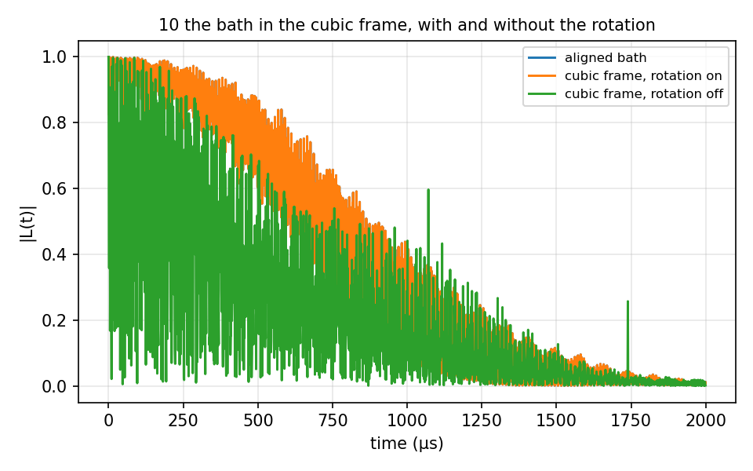

# 10 Coordinate frame rotation

`coordinate_frame_rotation`: CCEX applies `bfield` along z, so a bath written in
the crystal frame has to be rotated first. `HahnEcho_CCE2/` runs the NV of 02
three ways: the bath as generated (NV axis along z), the same bath rewritten in
the cubic frame with the rotation on (`qubit_axis` [1,1,1]), and that cubic
bath with the rotation off. The rotated bath reproduces the original to 1e-10;
with the rotation off the field sits 54.7° from the NV axis and the echo is a
different curve. 10 s.



## The input

`example/tutorial/10_Coordinate_rotation/HahnEcho_CCE2/ccein_cubic_rotated.json`; the aligned input has no rotation block; the no-rotation input turns it off on the same bath. `run.sh` in the same folder runs it as
`mpirun -n $NP bin/main.out -f <this file> -I <bath> -o results/<name>` and then the analyzer.

```
{
    # Config (General)
    "method"        : "cCCE",
    "quantity"      : "coherence",
    "Qubit"         : {
        "file"          : "../bath/bath_Diamond_NV_natab_defect",
        # Qubit : ms = +1 / 0 of the NV, one pi pulse (Hahn echo)
        "alphams"        : 1,
        "betams"         : 0
    },
    "gyrofile"      : "../bath/gyro_13C",
    "bathfile"      : ["../bath/bath_Diamond_NV_natab_cubic_1"],
    "order"         : 2,
    "bfield"        : 500,
    "rbath"         : 50,
    "rdip"          : 10,
    "deltat"        : 0.001,
    "nstep"         : 2000,
    "pulse"         : {"count": 1},

    # Coordinate frame : the bath file is written in the cubic crystal frame, where the NV
    # axis is [111]. Rotate positions (about the reference qubit) so that qubit_axis lands
    # on the z axis, along which "bfield" is applied. "enabled": false or no block at all
    # leaves the bath as written.
    "coordinate_frame_rotation" : {
        "enabled"    : true,
        "bath_axis"  : [0, 0, 1],
        "qubit_axis" : [1, 1, 1]
    },

    "outfile"       : "./results/CCE2_cubic_rotated_1"
}
```
