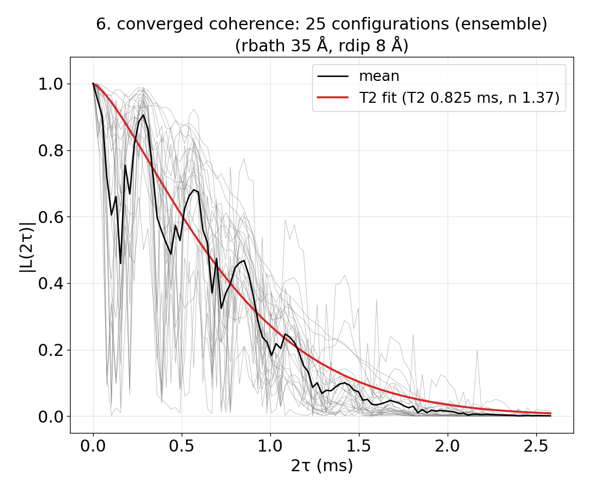

# 11 Automatic convergence

The `auto_convergence` block: with it, `mpirun -n $NP bin/main.out -f ccein.json` runs the
automatic convergence (keys in [InputFile_AutoConvergence.md](InputFile_AutoConvergence.md), the steps in `example/tools/AutoConvergence/README.md`) instead of one
calculation. `ensemble_CCE2/` takes 02's NV (CCE2 Hahn echo, ensemble) on 40 bath
configurations that `run.sh` makes first (a 110 Å cell each, configuration k from the random
seed k, into `results/bath/`), with the rdip candidates 4–12 Å and the rbath candidates
30–45 Å given. The runner split the configurations into 10 for the tests and 30 for the
production, and found the window 2.58 ms (1.5 × T_d 1.72 ms), rdip 8 Å, rbath 35 Å and 25
production configurations (SE(A)/A 4.0 % against the target 5 %): status `converged`, exit 0.
`results/auto/result/` holds `summary.txt`, the figures of each step and `coherence_mean.txt`.
The combination check warns that rbath 35, rdip 8 differs from the largest computed setting
by 9 % in the area, and the 101 time points alias the ¹³C ESEEM (the runner does not choose
`nstep`); both are in `example/tutorial/11_Auto_convergence/README.md`. 3 min 24 s for the
baths, 42 s for the convergence.



## The input

`example/tutorial/11_Auto_convergence/ensemble_CCE2/ccein.json`. `run.sh` in the same folder runs it as
`mpirun -n $NP bin/main.out -f ccein.json` and then prints `results/auto/result/summary.txt`.

```
{
    # Config (General) : the physics only. rbath, rdip and the time window are not given: the
    #                    auto_convergence block finds them. nstep is the number of time points of
    #                    every run; deltat only sets the first window ((nstep - 1) x deltat = 1 ms).
    "method"        : "CCE",
    "quantity"      : "coherence",
    "qubitfile"     : "results/bath/config_defect",
    "gyrofile"      : "../../02_Diamond_NV_natab/bath/gyro_13C",
    "order"         : 2,
    "bfield"        : 500,
    "deltat"        : 0.01,
    "nstep"         : 101,
    "seed"          : 1,
    # nstate 0 : the ensemble, one curve per bath configuration; only the number of configurations is chosen
    "nstate"        : 0,

    # Qubit : ms = +1 / 0 of the NV, one pi pulse (Hahn echo)
    "qalphams"       : 1,
    "qbetams"        : 0,
    "npulse"        : 1,

    # auto_convergence : with this block "mpirun -n N main.out -f ccein.json" runs the automatic convergence
    #                    (example/tools/AutoConvergence/README.md) instead of one calculation: every CCEX run
    #                    goes to its own folder under workdir/runs/, the decisions to workdir/decisions.jsonl,
    #                    the summary and the figures to workdir/result/.
    #   configurations : the bath files (run.sh makes 40 of them in results/bath/). Every file of the pattern is
    #                    found; 10 go to the convergence tests (chosen evenly over the distance of each
    #                    configuration's nearest 13C to the NV) and the rest to the production.
    #   rdip, rbath    : the candidates (A); the largest is the reference. Left out, they are found from the
    #                    spin density around the qubit (more runs).
    #   thresholds     : left at their defaults: rdip and rbath agree when the area under the T2 fit differs
    #                    by at most 2 %; the configurations are enough when SE(A)/A <= 5 %.
    "auto_convergence" : {
        "workdir"        : "results/auto",
        "configurations" : {"bathfile" : "results/bath/config_{k}"},
        "rdip"           : {"candidates" : [4, 6, 8, 10, 12]},
        "rbath"          : {"candidates" : [30, 35, 40, 45]}
    }
}
```
