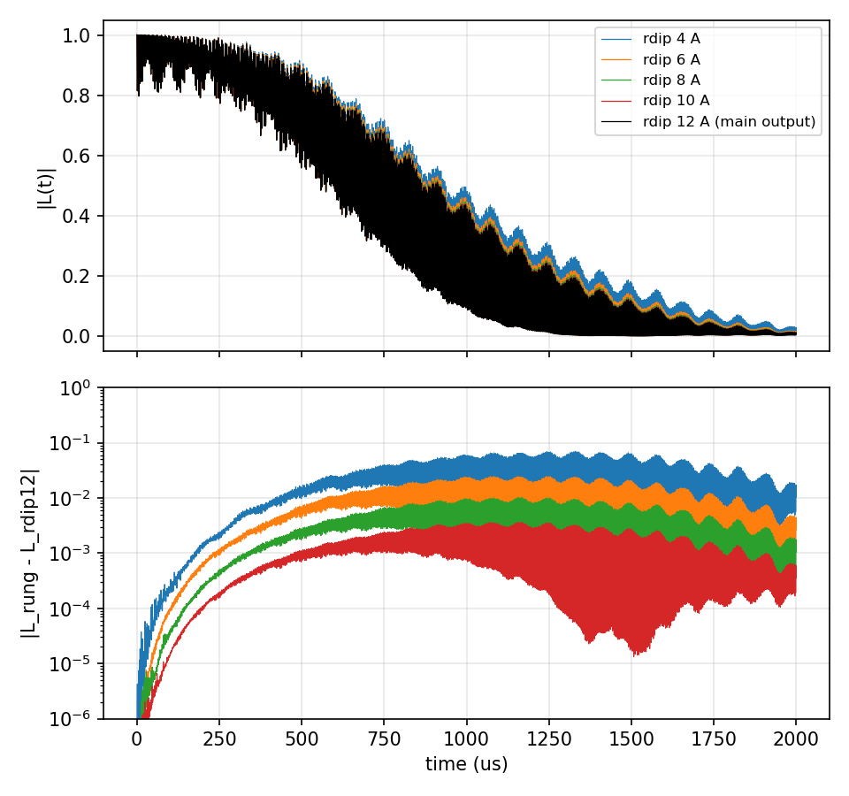

# 12 rdip ladder

`rdip_ladder` and `evolution_update`, on 02's NV (CCE2 Hahn echo, rbath 50, rdip 12, 10000
points of 0.2 µs). One run with `rdip_ladder` [4, 6, 8, 10] writes, beside its main output at
rdip 12, the curve of each rung (`<outfile>_rdip<r>_wiDiv`), each equal to a separate run at
that rdip: the rdip-6 rung against the separate rdip-6 run differs by 0, the main output
against the run without the ladder by 0. The rungs differ from the rdip-12 curve by at most
7.0e-2 (4 Å) down to 3.6e-3 (10 Å). The same input with `evolution_update` `exact` and
`recursive` (the CPU default since 2026-10-12): the curves differ by 1.0e-10 at most, one unit
of the last decimal written, and the runs took 5.5 s and 4.6 s. The ladder run took 6.8 s.



## The input

`example/tutorial/12_rdip_ladder/ensemble_CCE2/ccein_ladder.json`; `ccein_rdip6.json` is the same at rdip 6 without the ladder, `ccein_exact.json` and `ccein_recursive.json` at rdip 12 without it, with `evolution_update` given. `run.sh` in the same folder runs it as
`mpirun -n $NP bin/main.out -f <this file> -I <bath> -o results/<name>` and then the comparisons and the plot.

```
{
    # Config (General) : 02's ensemble_CCE input with rdip 12
    "method"        : "CCE",
    "quantity"      : "coherence",
    "qubitfile"     : "../../02_Diamond_NV_natab/bath/bath_Diamond_NV_natab_defect",
    "gyrofile"      : "../../02_Diamond_NV_natab/bath/gyro_13C",
    "bathfile"      : ["../../02_Diamond_NV_natab/bath/bath_Diamond_NV_natab_1"],
    "order"         : 2,
    "bfield"        : 500,
    "rbath"         : 50,
    "rdip"          : 12,
    "deltat"        : 0.0002,
    "nstep"         : 10000,
    "seed"          : 1,

    # rdip_ladder : rungs below rdip (strictly increasing). The same run also writes, for every rung r, the curve a
    #               separate run at rdip = r gives: <outfile>_rdip<r>_wiDiv / _noDiv beside the main <outfile>_wiDiv,
    #               which stays the run at rdip 12. Order 2 only (CCE, gCCE, pCCE), quantity coherence, standard
    #               clusters, savemode coherence; anything else is refused with "Error: rdip_ladder ...".
    "rdip_ladder"   : [4, 6, 8, 10],

    # Qubit : ms = +1 / 0 of the NV, one pi pulse (Hahn echo)
    "qalphams"      : 1,
    "qbetams"       : 0,
    "npulse"        : 1,

    "outfile"       : "./results/CCE2_ladder_1"
}
```
