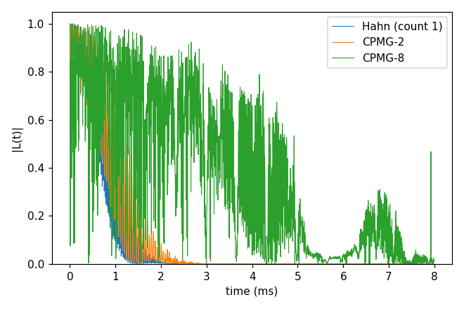
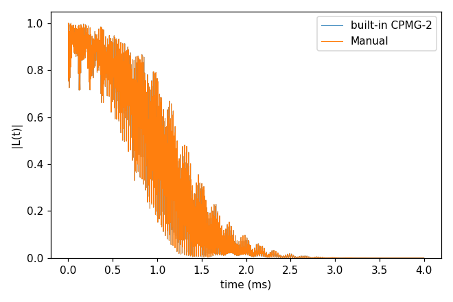

# 02_pulses

The NV of [00_quickstart](../00_quickstart/README.md) under different pulse sequences: Hahn echo (one π pulse), CPMG-N (N equally spaced π pulses)
and a sequence written out (`Manual`). Each folder: `cd <folder> && NP=4 bash run.sh`, then compare
`results/coherence.png` with `expected.png`. Every key not written in an input has its default (`main.out -e`).
Times: i7-14700K, WSL, 4 ranks.

## cCCE2_CPMG_ensemble

- **What it shows:** more π pulses refocus the ¹³C bath longer: T2 grows from the Hahn echo to CPMG-2 and CPMG-8.
- **Keys that matter:** `pulse.count` (8 in the input; `run.sh` also runs 1 and 2 through `set_input_keys.py`),
  `deltat` 4 µs × `nstep` 2000 (8 ms, long enough for CPMG-8).
- **How to run:** `NP=4 bash run.sh`: 3.6 s, 0.05 GB per rank.
- **Expected result:** `expected.png`; T2 Hahn 1.068 ms, CPMG-2 1.36 ms, CPMG-8 7.9 ms.
- **What to change next:** `pulse.count` 16 or 32 (with a longer window); the same on the P1 bath of [03_P1](../03_P1/README.md).

Input: [`ccein.jsonc`](cCCE2_CPMG_ensemble/ccein.jsonc)

## cCCE2_Manual_ensemble

- **What it shows:** a sequence written out, `pulse.name` `Manual` with one row `[fraction of the total time before
  the pulse, axis, angle in degrees]` per pulse and a last row for the free evolution after it (count + 1 rows; the
  fractions sum to 1). Written as a CPMG-2, it reproduces the built-in CPMG-2.
- **Keys that matter:** `pulse.count` 2, `pulse.name` `Manual`, `pulse.sequence`
  `[["1/4", "X", 180], ["1/2", "X", 180], ["1/4", "I", 0]]`.
- **How to run:** `NP=4 bash run.sh` (the Manual input, then the built-in CPMG-2 as `results/builtin.json`): 2.4 s,
  0.05 GB per rank.
- **Expected result:** `expected.png`; the two curves are identical (difference 0), T2 1.37 ms.
- **What to change next:** uneven spacings (UDD), or pulses that are not π flips (90° about X and Y, as in WAHUHA):
  those need `method` gCCE, since cCCE treats every pulse as a π flip and refuses others.

Input: [`ccein.jsonc`](cCCE2_Manual_ensemble/ccein.jsonc)
