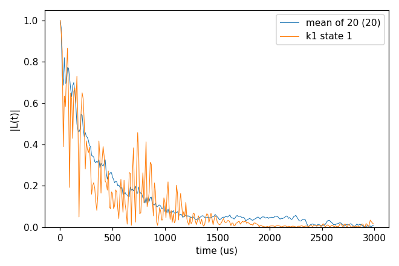
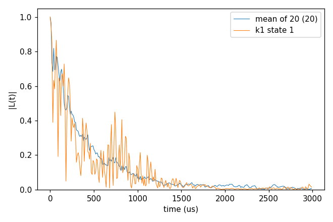
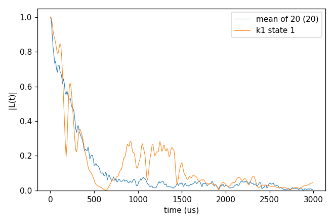
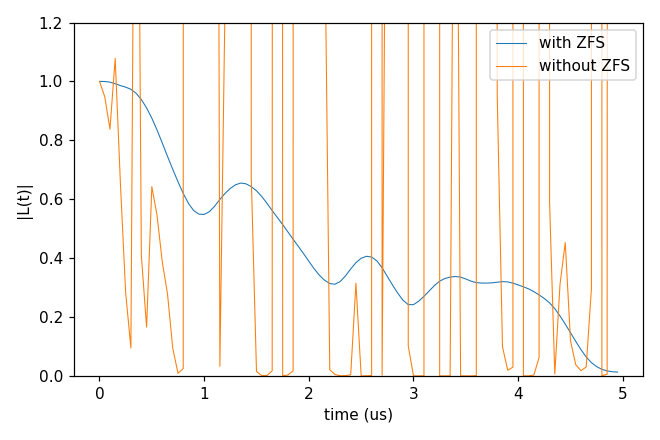
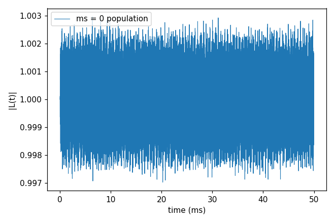
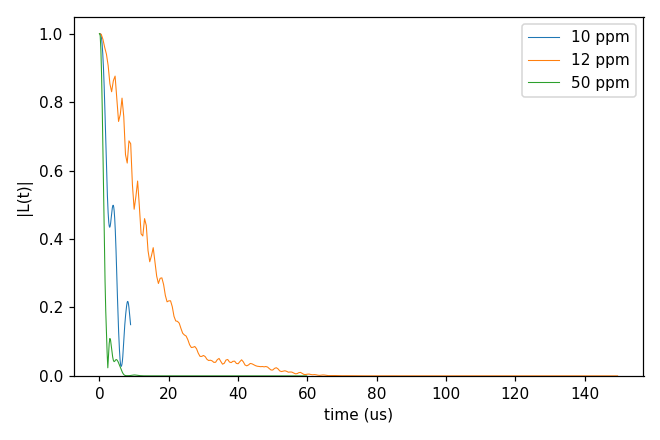
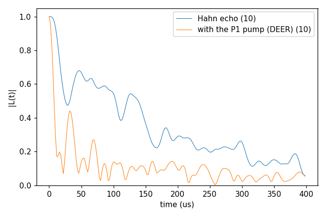
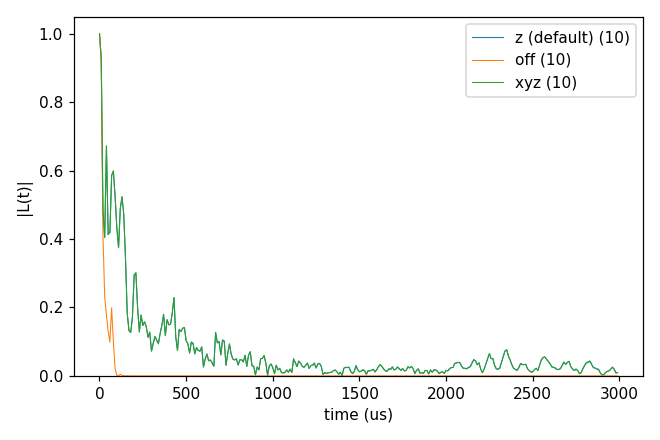

# 03_P1

An NV in a bath of electron spins: P1 centres (substitutional N, an electron spin 1/2 whose ¹⁴N hyperfine shifts it by
one of 12 detunings, one per Jahn-Teller axis and ¹⁴N state, the `Defect` block) at 1 and 10 ppm, and Vp defects
(spin 1/2, no `Defect` block). An electron bath couples more strongly than ¹³C, so the times are microseconds and the
bath is sampled in pure states (`s_range`, drawn from `seed`). Each folder: `cd <folder> && NP=4 bash run.sh`, then
compare `results/coherence.png` with `expected.png`. Every key not written in an input has its default
(`main.out -e`). Times: i7-14700K, WSL, 4 ranks.

`bath/` holds 5 configurations at 1 ppm (`14N_1ppm/`, cells for `rbath` 850 Å) and 5 at 10 ppm (`14N_10ppm/`), the
NV position of each (`_Defect`), the P1 gyromagnetic ratio (`DiaP1_gyro`) and the Vp baths (`Vp/`, one configuration
at 10, 12 and 50 ppm); larger sets (100 configurations at 1 to 100 ppm, 99 MB) are in git history.
The production runs these inputs were cut from used 50 configurations × 50 states (128 ranks on a cluster).

## cCCE2_Hahn_states

- **What it shows:** the Hahn echo of the NV (ms -1 / 0) in 1 ppm P1, cCCE2, averaged over 2 configurations
  (`k_range`) × 10 sampled states; one state alone gives a curve far from the mean.
- **Keys that matter:** `Qubit.alpha_state` `{"ms": [-1]}`, `bathfile` with `{k}` and `k_range` [1, 2], `s_range` [1, 10], `seed` (one per configuration), `rbath`
  850 Å, `rdip` 620 Å, `deltat` 10 µs × `nstep` 300, the `Defect` block (12 detunings).
- **How to run:** `NP=4 bash run.sh`: 2.2 s, 0.06 GB per rank.
- **Expected result:** `expected.png`; T2 of the mean of 20 curves 295 µs.
- **What to change next:** `k_range` [1, 5] and `s_range` [1, 50] (the production numbers per configuration); `pulse.count` 8.

Input: [`ccein.jsonc`](cCCE2_Hahn_states/ccein.jsonc)

## cCCE4_Hahn_states

- **What it shows:** the same to order 4, the convergence check of the expansion; `cluster.selection.max_per_order`
  keeps the 5000 strongest three-spin and 10000 strongest four-spin clusters.
- **Keys that matter:** `order` 4, `cluster.selection.max_per_order` [0, 0, 0, 5000, 10000].
- **How to run:** `NP=2 bash run.sh` to stay within 2 GB: 0.84 GB per rank (the cluster list); 34 s on 2 ranks.
- **Expected result:** `expected.png`; T2 of the mean 295 µs, the same as order 2 (converged at order 2 here).
- **What to change next:** `max_per_order` 0 (all clusters; much more memory).

Input: [`ccein.jsonc`](cCCE4_Hahn_states/ccein.jsonc)

## cCCE2_Hahn_onsite14N

- **What it shows:** each P1 written with its ¹⁴N as an on-site nuclear spin (`n_onsite_spins` 1, four Jahn-Teller
  axes with the ¹⁴N hyperfine and quadrupole tensors), so a cluster of one P1 is its electron and its ¹⁴N.
- **Keys that matter:** the `Defect` species: `n_onsite_spins`, `types`, `spins`, `gyros`, `quadrupole_moments`,
  `n_axis_states` 4, `hyperfine`, `efg`.
- **How to run:** `NP=4 bash run.sh`: 65 s, 0.07 GB per rank.
- **Expected result:** `expected.png`; T2 of the mean 322 µs (against 295 µs with the detunings of `cCCE2_Hahn_states`).
- **What to change next:** the on-site states from a file (`configuration.defect_state_file`).

Input: [`ccein.jsonc`](cCCE2_Hahn_onsite14N/ccein.jsonc)

## gCCE2_Hahn_zfs

- **What it shows:** at zero field the NV must be a spin 1 with its zero-field splitting (D = 2.88 GHz, the `intmap`
  tensor in kHz) in gCCE; without it the ms ±1 levels are degenerate and the divided curve (`_wiDiv`) diverges.
- **Keys that matter:** `method` gCCE, `bfield` 0, the `Qubit.qubit` entry and its `intmap` self tensor (present in
  `ccein_with_ZFS.jsonc`, absent in `ccein_without_ZFS.jsonc`), `s_range` [1, 1], `seed` 8810, 10 ppm, `deltat` 50 ns.
- **How to run:** `NP=4 bash run.sh`: 1.5 s, 0.06 GB per rank.
- **Expected result:** `expected.png`; T2 with the ZFS 2.70 µs; without it |L| reaches 4.6e37 (cut at 1.2 in the
  plot).
- **What to change next:** a small field (`bfield` 10) without the ZFS; more states.

Inputs: [`ccein_with_ZFS.jsonc`](gCCE2_Hahn_zfs/ccein_with_ZFS.jsonc), [`ccein_without_ZFS.jsonc`](gCCE2_Hahn_zfs/ccein_without_ZFS.jsonc)

## gCCE2_Ramsey_population

- **What it shows:** the NV prepared in ms = 0 (`alpha_state` = `beta_state` = `{"ms": [0]}`), no pulse, the qubit density matrix
  (`quantity` dm) of gCCE2 over 50 ms in 10 ppm P1 at 300 G: the ms = 0 population, which flip-flops with the bath
  would lower.
- **Keys that matter:** `quantity` dm, `alpha_state` / `beta_state` `{"ms": [0]}`, `pulse.count` 0, `bfield` 300, `deltat` 10 µs ×
  `nstep` 5000.
- **How to run:** `NP=4 bash run.sh`: 76 s, 0.06 GB per rank.
- **Expected result:** `expected.png` (the y range from the data); the population stays within 0.997 to 1.003.
- **What to change next:** a scan of `bfield`: where an NV transition comes into resonance with the bath, the
  population drops.

Input: [`ccein.jsonc`](gCCE2_Ramsey_population/ccein.jsonc)

## cCCE2_Hahn_VpBath

- **What it shows:** the Hahn echo in a bath of Vp defects (spin 1/2 without on-site nuclei: no `Defect` block) at
  10, 12 and 50 ppm, one configuration and one sampled state each.
- **Keys that matter:** `configuration.gyrofile` (`Vp/DiaVp_gyro`), `bathfile`, `s_range` [1, 1], `seed`, `rbath`, `rdip`
  and `deltat` per concentration.
- **How to run:** `NP=4 bash run.sh`: 1.7 s, 0.06 GB per rank.
- **Expected result:** `expected.png`; T2 4.8 µs (10 ppm), 15.6 µs (12 ppm, a longer window), 1.4 µs (50 ppm) for this
  one state.
- **What to change next:** more states (`s_range` [1, 20]) before comparing concentrations.

Inputs: [`ccein_10ppm.jsonc`](cCCE2_Hahn_VpBath/ccein_10ppm.jsonc), [`ccein_12ppm.jsonc`](cCCE2_Hahn_VpBath/ccein_12ppm.jsonc), [`ccein_50ppm.jsonc`](cCCE2_Hahn_VpBath/ccein_50ppm.jsonc)

## gCCE2_Hahn_DEER

- **What it shows:** a DEER pump (`pulse.bath`): a π pulse on the P1 spins at the time of the NV's π pulse
  (`ccein_pump.jsonc`) against the plain Hahn echo (`ccein_nopump.jsonc`), gCCE2, NV ms +1 / 0, 1 ppm, ten sampled
  states. The tone `energy_shift` 0 MHz drives only the P1 whose `detuning` is within `bandwidth` of it (the central
  ¹⁴N line, axis states 4, 5, 6 and 11); their coupling to the NV is no longer refocused, so the echo decays faster.
  (At 500 G the NV's ms −1 / 0 transition is close to the P1 lines and its gCCE2 curve diverges, hence ms +1.)
- **Keys that matter:** `method` gCCE, `pulse.bath` {`count` 1, `defect` "P1", `energy_shift` [0.0], `sequence`
  [["1/2", "X", 180], ["1/2", "I", 0]]}, the `Defect` detunings, `s_range` [1, 10], `seed`.
- **How to run:** `NP=4 bash run.sh`: 9 s, 0.06 GB per rank.
- **Expected result:** `expected.png`; T2 of the mean of the 10 states 150 µs (Hahn echo) and 36 µs (with the pump).
- **What to change next:** another tone (`energy_shift` [84.946496] drives the axis states 1-3), or the pump at another
  time (`pulse.bath.sequence` [["0.3", "X", 180], ["0.7", "I", 0]]); see [DEER bath pulses](../../../docs/methods/deer.md).

Inputs: [`ccein_nopump.jsonc`](gCCE2_Hahn_DEER/ccein_nopump.jsonc), [`ccein_pump.jsonc`](gCCE2_Hahn_DEER/ccein_pump.jsonc)

## cCCE2_Hahn_meanField

- **What it shows:** with sampled bath states each cluster feels the static field of the bath spins outside it
  (`hamiltonian.common.bath_bath_mean_field`): its z part (`ccein_z.jsonc`, the default), left out (`ccein_off.jsonc`)
  and the whole vector (`ccein_xyz.jsonc`); cCCE2, 1 ppm, one configuration, ten states. Without it the P1 of a pair
  are no longer detuned from each other by the field of their neighbours, and the echo decays much faster.
- **Keys that matter:** `hamiltonian.common.bath_bath_mean_field` "z", "off", "xyz"; `s_range` [1, 10] (in the ensemble
  the key is not used).
- **How to run:** `NP=4 bash run.sh`: 3 s, 0.05 GB per rank.
- **Expected result:** `expected.png`; T2 of the mean 148 µs (z), 22 µs (off), 148 µs (xyz, largest difference from
  z 2.6e-3).
- **What to change next:** the 10 ppm bath, with closer P1 pairs.

Inputs: [`ccein_off.jsonc`](cCCE2_Hahn_meanField/ccein_off.jsonc), [`ccein_xyz.jsonc`](cCCE2_Hahn_meanField/ccein_xyz.jsonc), [`ccein_z.jsonc`](cCCE2_Hahn_meanField/ccein_z.jsonc)
