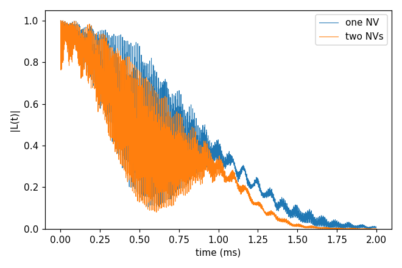
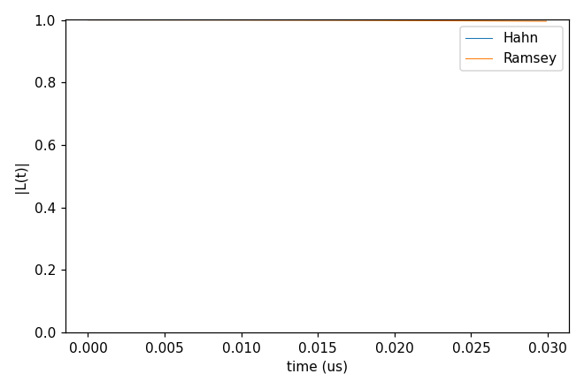

# 05_multiNV

Several NV centres as one qubit register in a shared ¹³C bath, with gCCE (every qubit a spin 1 with its zero-field
splitting, the `intmap` self tensors in kHz; the qubits coupled by their dipolar interaction from the positions). Each
folder: `cd <folder> && NP=4 bash run.sh`, then compare `results/coherence.png` with `expected.png`. Every key not
written in an input has its default (`main.out -e`). Times: i7-14700K, WSL, 4 ranks.

## gCCE2_Hahn_oneVsTwoNV

- **What it shows:** the Hahn echo of one NV (`ccein_single.jsonc`, the qubit's position from a file, `Qubit.qubit[].file`, with its ZFS) against two NVs
  25 Å apart along z in the same bath (`ccein_multi2.jsonc`, the `Qubit.qubit` list; coherence between |+1,+1⟩ and
  |0,0⟩), 00_quickstart's bath.
- **Keys that matter:** `method` gCCE, `Qubit.qubit` (two entries with `xyz`) and `Qubit.intmap` (one ZFS tensor each),
  or a `Qubit.qubit[].file` entry, with its ZFS as a `Qubit.intmap` self entry.
- **How to run:** `NP=4 bash run.sh`: 2 min (the two-NV run), 0.07 GB per rank.
- **Expected result:** `expected.png`; T2 one NV 1.068 ms, two NVs 0.945 ms.
- **What to change next:** the second NV further away (`xyz`), or `alpha_state` / `beta_state` for another pair of
  register states.

Inputs: [`ccein_multi2.jsonc`](gCCE2_Hahn_oneVsTwoNV/ccein_multi2.jsonc), [`ccein_single.jsonc`](gCCE2_Hahn_oneVsTwoNV/ccein_single.jsonc)

## gCCE2_HahnRamsey_NV2

- **What it shows:** two NVs 50 Å apart and a pair of ¹³C near the first, the 2-qubit density matrix (`quantity` dm)
  for the bath state in the file `state1`, Hahn echo (`ccein_hahn.jsonc`) and Ramsey (`ccein_ramsey.jsonc`, `pulse.count`
  0), over 30 ns; the plot shows ρ between |+1,+1⟩ and |0,0⟩ divided by its value at t = 0. The bath, gyro and state
  files of this folder are written by hand (`bath`: a count line, then x y z name).
- **Keys that matter:** `quantity` dm, `Qubit.qubit` / `intmap`, `configuration.bath_state_file` ["state"] with
  `s_range` [1, 1], `rbath` and `rdip` large enough to take every spin, `deltat` 0.1 ns × `nstep` 300.
- **How to run:** `NP=4 bash run.sh`: under 1 s, 0.05 GB per rank.
- **Expected result:** `expected.png`; |L| 1.000 (Hahn) and 0.996 (Ramsey) at 30 ns.
- **What to change next:** a longer window (`deltat`), or order 1 to see what the pair cluster adds.

Inputs: [`ccein_hahn.jsonc`](gCCE2_HahnRamsey_NV2/ccein_hahn.jsonc), [`ccein_ramsey.jsonc`](gCCE2_HahnRamsey_NV2/ccein_ramsey.jsonc)

## gCCE2_HahnRamsey_NV6

- **What it shows:** the same with six NVs (a register of dimension 3⁶ = 729; with the two ¹³C, clusters of dimension
  2916), reading `../gCCE2_HahnRamsey_NV2/`'s bath, gyro and state files.
- **Keys that matter:** six `Qubit.qubit` entries and six `intmap` tensors; `nstep` 50 (at 300 the density
  matrices, 8.5 MB per time step, ran out of memory at 32 ranks on a GPU server node).
- **How to run:** a server node, not a laptop: `NP=8 bash run.sh` (each output file holds nstep × 729² complex numbers).
- **Expected result:** no `expected.png` yet: the run needs a server node.
- **What to change next:** fewer qubits first (`gCCE2_HahnRamsey_NV2`).

Inputs: [`ccein_hahn.jsonc`](gCCE2_HahnRamsey_NV6/ccein_hahn.jsonc), [`ccein_ramsey.jsonc`](gCCE2_HahnRamsey_NV6/ccein_ramsey.jsonc)
