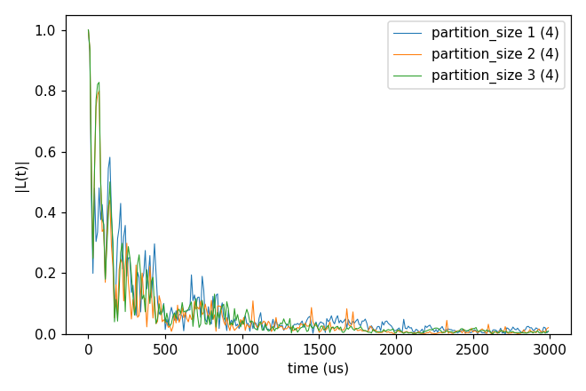
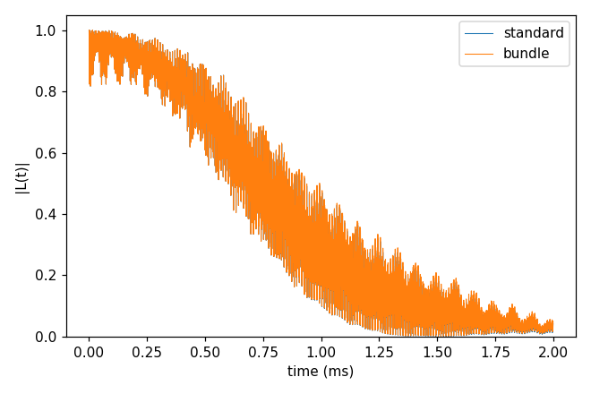
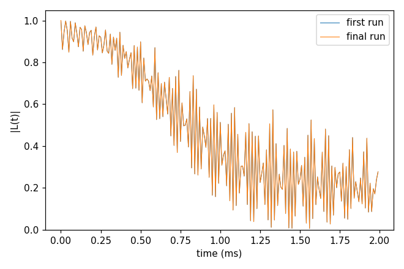
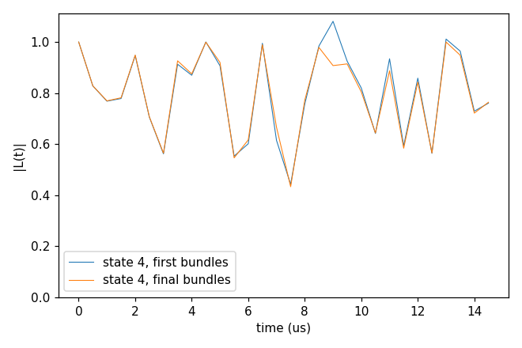
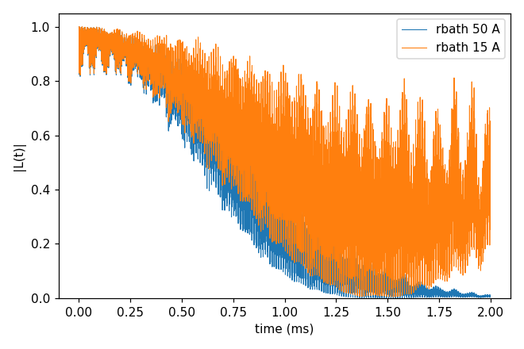

# 07_pCCE_and_bundle

Clusters made of groups instead of single spins. **pCCE** (`cluster.mode` pcce) groups the bath into partitions of
`partition_size` spins by k-means on the positions and runs the expansion over partitions (order 2 = pairs of
partitions). **Bundle clustering** (`cluster.mode` bundle) bundles strongly coupled spins,
from the coupling strengths and under the dimension cap `cluster.bundle.max_dim`, and every bundle enters a cluster whole;
`order` counts bundles. **Adaptive refinement** (the `cluster.adaptive` block,
[Cluster tags](../../../docs/user/InputFile_Cluster.md#tag_adaptive)) repeats the bundled calculation, measures the error at the bundle boundaries
and re-bundles. Each folder: `cd <folder> && NP=4 bash
run.sh`, then compare `results/coherence.png` with `expected.png`. Every key not written in an input has its default
(`main.out -e`). Times: i7-14700K, WSL, 4 ranks.

## pCCE2_Hahn_states

- **What it shows:** pCCE2 of the NV in 1 ppm P1 ([03_P1](../03_P1/README.md)'s bath, one configuration, four sampled states) with
  partitions of 1, 2 and 3 P1 (`partition_size` 1 is ordinary CCE2 over single spins).
- **Keys that matter:** `cluster.mode` pcce, `cluster.pcce.partition_size` (2 in the input; `run.sh` sets 1, 2, 3 or
  `SIZES`), `trials`, `max_iterations`.
- **How to run:** `NP=4 bash run.sh`: 8 s, 0.06 GB per rank. `SIZES="1 2 3 4" bash run.sh` adds 4 (much longer).
- **Expected result:** `expected.png`; T2 213 µs (size 1), 145 µs (2), 152 µs (3) for these four states.
- **What to change next:** more states (`s_range`) before reading the differences; `cluster.pcce.connections` spins.

Input: [`ccein.jsonc`](pCCE2_Hahn_states/ccein.jsonc)

## cCCE2_Hahn_bundle

- **What it shows:** 00_quickstart's NV (`rbath` 30) with ordinary clusters (`ccein_standard.jsonc`) and with bundles of
  up to three ¹³C (`bundle.max_dim` 8, `ccein_bundle.jsonc`); the `[adaptive]` log line says how the 199 spins were
  bundled (84 bundles).
- **Keys that matter:** `cluster.mode` bundle, `cluster.bundle.max_dim` 8.
- **How to run:** `NP=4 bash run.sh`: 2.7 s, 0.05 GB per rank.
- **Expected result:** `expected.png`; T2 1.101 ms (standard) and 1.158 ms (bundles); largest difference 0.017.
- **What to change next:** `max_dim` 4 (pairs) or 16.

Inputs: [`ccein_bundle.jsonc`](cCCE2_Hahn_bundle/ccein_bundle.jsonc), [`ccein_standard.jsonc`](cCCE2_Hahn_bundle/ccein_standard.jsonc)

## cCCE2_Hahn_adaptive

- **What it shows:** the bundled calculation (`rbath` 20, 2 ms) with adaptive refinement, merge policy, `atol` 1e-3:
  three rounds (28 → 26 bundles), then "no feasible improving merge" (exit status 2); `results/adaptive/` holds one
  folder per step and `summary.json`. `adaptive` needs an explicit `seed`: every round recomputes the same system.
- **Keys that matter:** `cluster.adaptive` {`output`, `atol`, `rtol`, `max_rounds`}, `configuration.seed`.
- **How to run:** `NP=4 bash run.sh`: 48 s, 0.12 GB per process.
- **Expected result:** `expected.png` (first and final run); T2 1.92 ms in both, largest difference 1.4e-5 (the merges
  hardly move this curve).
- **What to change next:** `atol` 1e-4; `max_rounds` 8.

Input: [`ccein.jsonc`](cCCE2_Hahn_adaptive/ccein.jsonc)

## cCCE2_Hahn_regroup

- **What it shows:** the NV in six P1 electron spins (`bath/bath_p1_6`, five sampled states, bundles up to dimension 4)
  with `"regroup": true`: the bundles [0,3] [1,5] [2,4] give three states with |L| > 1.01; the culprit pairs are found
  and one change, splitting [2,4], is accepted; the rerun has no unphysical state (status `physical`, exit 0). The NV
  position and the P1 gyromagnetic ratio are [08_GPU](../08_GPU/README.md)'s.
- **Keys that matter:** `cluster.adaptive.regroup` true, `cluster.bundle.max_dim` 4, `s_range` [1, 5], `seed`.
- **How to run:** `NP=4 bash run.sh`: 1 s, 0.06 GB per rank.
- **Expected result:** `expected.png` (state 4 before and after); the printed rounds: culprit pairs [0,3]-[1,5]
  (g 1.63), [0,3]-[2,4] (0.10), [1,5]-[2,4] (5e-4), final bundles [[0,3], [1,5], [2], [4]].
- **What to change next:** `max_dim` 8; more states.

Input: [`ccein.jsonc`](cCCE2_Hahn_regroup/ccein.jsonc)

## cCCE2_Hahn_clusterReport

- **What it shows:** what a run can report about its clusters, on 00_quickstart's system. `ccein_contributions.jsonc`
  (`output.cluster_contributions`): `results/ccein_contributions.contributions.state-0.tsv`, one row per cluster
  (sites, dimension, the largest |log L̃| over the time points and the step where it is reached, ...), and
  `.contributions.sites.tsv` (each site's name, spin, γ and position); `savemode` with `nodiv` false writes `_wiDiv`
  alone. `ccein_plan.jsonc` (`output.cluster_only` true): the cluster list in `results/ccein_plan.clusters.json`, no
  dynamics. `ccein_curves.jsonc` (`output.savemode` `cluster_coherence`, `rbath` 15 Å): beside the result, the
  coherence of each of its 116 clusters, `results/ccein_curves_<bath indices>_wiDiv` and `_noDiv`.
- **Keys that matter:** `output.cluster_contributions` {`enabled` true}, `output.savemode` {`mode`, `nodiv`},
  `output.cluster_only`.
- **How to run:** `NP=4 bash run.sh`: 1.3 s, 0.05 GB per rank. Sorting the table by its fifth column
  (`sort -t "$(printf '\t')" -k5 -g -r`) lists the clusters that matter most: here the pair 519,557 (|log L̃| 4.8).
- **Expected result:** `expected.png`; T2 1.068 ms (rbath 50 Å, the quickstart curve); |L| 0.65 at 2 ms with rbath
  15 Å.
- **What to change next:** `savemode` `cluster_density_matrix` with gCCE on a few spins
  (`06_cCCE_vs_gCCE/gCCE1_Hahn_handwritten`).

Inputs: [`ccein_contributions.jsonc`](cCCE2_Hahn_clusterReport/ccein_contributions.jsonc), [`ccein_curves.jsonc`](cCCE2_Hahn_clusterReport/ccein_curves.jsonc), [`ccein_plan.jsonc`](cCCE2_Hahn_clusterReport/ccein_plan.jsonc)
