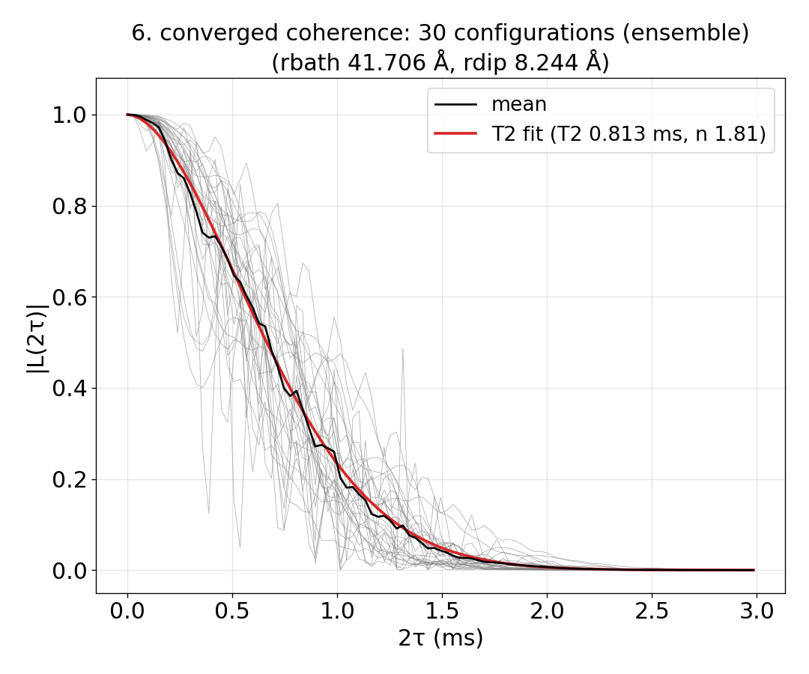

# 09_auto_convergence

The automatic convergence (the `auto_convergence` block). With the block, `mpirun -n N main.out -f ccein.jsonc` does not
run one calculation: rank 0 starts the runner (`example/tools/AutoConvergence/`, Python with numpy, scipy and
matplotlib), which runs CCEX itself, each run in its own folder with `mpirun -n N`, chooses the time window, rdip,
rbath and the number of bath configurations, and then computes the production. The rules are in
[Automatic convergence tags](../../../docs/user/InputFile_AutoConvergence.md) (and in
`example/tools/AutoConvergence/README.md`). Every key not written in the
input has its default (`main.out -e`).

## cCCE2_Hahn_ensemble

- **What it shows:** 00_quickstart's NV, cCCE2 Hahn echo of the ensemble, with the rdip candidates 4-12 Å and the
  rbath candidates 30-45 Å given and everything else found: the window (1.5 × the decay time), rdip, rbath and how
  many configurations the mean needs (SE(A)/A ≤ 5 %).
- **Keys that matter:** `auto_convergence` {`workdir`, `rdip.candidates`, `rbath.candidates`, `sampling`},
  `configuration.bathfile` ["results/bath/config_{k}"] (every existing k is used), `nstep` 101 (the points of every
  run), `deltat` (only the first window).
- **How to run:** `NP=4 bash run.sh` makes 40 configurations first (`../../make_natab_baths.sh`, 110 Å cells: up to
  rbath 53 Å; `NBATH` sets how many) and runs the convergence: 2 min in all (i7-14700K, WSL, 4 ranks), under 0.2 GB per
  process. Calling it again continues (the baths are kept, finished runs and decisions reused). The automatic
  convergence exits 0 when `converged` and 3 when `unresolved` (the summary says what is missing); `run.sh` prints
  that status and `results/auto/result/summary.txt`.
- **Expected result:** `expected.png` (the runner's `6_converged_coherence.png`); status converged: window 2.58 ms,
  rdip 8 Å, rbath 35 Å, 25 production configurations (σA/A 4.0 %), T2 0.82 ms (stretched-exponential fit, n 1.37).
  `results/auto/result/` also has `1_window.png`, `2_rdip.png`, `3_rbath.png`, `5_configurations.png` and
  `coherence_mean.txt`.
- **What to change next:** leave out `rdip` and `rbath` (the runner proposes candidates from the spin density; more
  runs); raise `nstep`: the 101 points over 2.58 ms are 26 µs apart, coarser than the ¹³C precession at 500 G (about
  2 µs), so the ESEEM ripple is aliased (the runner keeps `nstep` and does not check it).

What the result does not say: the combination check (rbath 35, rdip 8 against the largest computed, rbath 45, rdip 15,
on three production configurations) differs by 9 % in the area, more than the 2 % threshold of each step (a warning in
the summary).

Input: [`ccein.jsonc`](cCCE2_Hahn_ensemble/ccein.jsonc)

## cCCE2_Hahn_ensemble_noCandidates

- **What it shows:** the same calculation with the `rdip` and `rbath` blocks left out: the runner counts the ¹³C of the
  test configurations and starts from 4 rbath candidates 1.25 apart, the largest where 300 spins are inside (33.4 Å),
  and 7 rdip candidates 0.8 apart below 1.25² × the pair-phase estimate (8.2 Å), then raises the largest of each until
  the comparisons agree (`example/tools/AutoConvergence/autoconv/autostart.py`).
- **Keys that matter:** `auto_convergence` {`workdir`, `sampling`} only; the rest as in `cCCE2_Hahn_ensemble`.
- **How to run:** `NP=4 bash run.sh`. The baths are made in 140 Å cells (rbath up to 68 Å): found candidates need two
  agreeing comparisons in a row, so rbath converges only against 65.2 Å; with the 110 Å cells of `cCCE2_Hahn_ensemble`
  (53 Å) the run stops as `truncation-unresolved`, asking for baths covering 65.5 Å.
- **Expected result:** `expected.png` (the runner's `6_converged_coherence.png`); status converged. The two cases
  (i7-14700K, WSL, 4 ranks; most of the time is making the 40 baths, done once):

  | | rdip | rbath | window | configurations | T2 (n) | time in all (baths + runner) | peak memory |
  |---|---|---|---|---|---|---|---|
  | `cCCE2_Hahn_ensemble` (candidates given) | 8 Å | 35 Å | 2.58 ms | 25 | 0.82 ms (1.37) | 4.8 min (3.9 + 0.8) | 0.18 GB |
  | `cCCE2_Hahn_ensemble_noCandidates` | 8.24 Å | 41.7 Å | 2.98 ms | 30 | 0.81 ms (1.81) | 6.9 min (5.6 + 1.2) | 0.19 GB |

  The T2 agree within 2 %, the exponents do not (1.37, 1.81); the bath configurations are not the same (other cell
  size). The combination check differs by 5.7 % here (9 % above), again a warning in the summary.

Input: [`ccein.jsonc`](cCCE2_Hahn_ensemble_noCandidates/ccein.jsonc)
