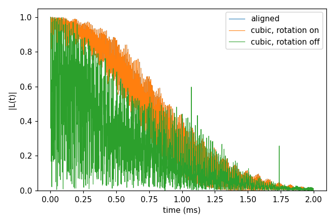

# 10_coordinate_rotation

The coordinate-frame rotation (`frame.rotation`). CCEX builds the Hamiltonian in a frame whose z is the qubit's axis,
and reads `bfield` in that frame. Without the rotation that frame is the bath file's own, so a bath written in a frame
where the defect axis is not z has to be turned: by hand, or by this block, which turns every position about the
qubit so that `qubit_axis` (written in the bath file's frame) becomes z. `"bfield": 500` is then 500 G along
`qubit_axis` in the lab. The block is on when it is written. Tensors and Defect species written in the input say with a
key `"frame"` whether they are in the bath file's frame (`"file"`, turned with the positions) or already in the turned
one (`"qubit"`); this example has none (the NV's zero-field splitting is not in the input). [The coordinate frame
rotation](../../../docs/methods/coordinate-frame-rotation.md) explains what moves and what does not. Every key not
written in an input has its default (`main.out -e`). Times: i7-14700K, WSL, 4 ranks.

`bath/bath_Diamond_NV_natab_cubic_1` is 00_quickstart's bath rotated so that the NV axis points along [111], as a bath
written in the conventional cubic cell would; `bath/make_cubic_frame.py` made it from `00_quickstart/bath/` and says how.

## cCCE2_Hahn_rotation

- **What it shows:** the Hahn echo of 00_quickstart's NV three ways: the bath as generated (NV axis along z,
  `ccein_aligned.jsonc`), the cubic-frame bath with the rotation on (`qubit_axis` [1, 1, 1], `ccein_cubic_rotated.jsonc`),
  and the cubic-frame bath without it (`ccein_cubic_norotation.jsonc`: the field is 54.7° off the NV axis).
- **Keys that matter:** `frame.rotation.qubit_axis` [1, 1, 1]; `configuration.bathfile` (the cubic-frame file).
- **How to run:** `cd cCCE2_Hahn_rotation && NP=4 bash run.sh`: 1.8 s, 0.05 GB per rank.
- **Expected result:** `expected.png`; the rotated run reproduces the aligned one (largest difference 1e-10, T2 1.068
  ms); without the rotation T2 is 1.117 ms and the curve differs by up to 0.91.
- **What to change next:** `bfield` as a vector to tilt the field on purpose (without the rotation; with it a
  transverse field is refused); a bath with DFT tensors (`hamiltonian.common.hyperfine.frame`, `quadrupole.frame`).

Inputs: [`ccein_aligned.jsonc`](cCCE2_Hahn_rotation/ccein_aligned.jsonc), [`ccein_cubic_norotation.jsonc`](cCCE2_Hahn_rotation/ccein_cubic_norotation.jsonc), [`ccein_cubic_rotated.jsonc`](cCCE2_Hahn_rotation/ccein_cubic_rotated.jsonc)
